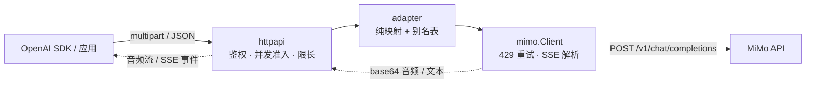

# MiMoVoice2API

把小米 MiMo 开放平台的语音识别（ASR）与语音合成（TTS）翻译成 OpenAI 兼容的 `/v1/audio/transcriptions` 与 `/v1/audio/speech`。单个 Go 二进制、无状态、零第三方依赖——客户端只改 `base_url` 就能接入。

[](https://github.com/mcxiaochenn/MiMoVoice2API/actions/workflows/ci.yml)
[](https://github.com/mcxiaochenn/MiMoVoice2API/releases)
[](go.mod)
[](LICENSE)

> **当前状态**：`v1.0.0` 已发布并处于维护态。转写、合成、流式输出、Prometheus 指标与 GHCR 多架构镜像均已可用。
> 完整接口契约见 [docs/api-spec.md](docs/api-spec.md)，实现细节见 [docs/architecture.md](docs/architecture.md)。

**目录**：[核心能力](#核心能力) · [为什么需要它](#为什么需要它) · [架构](#架构) · [快速开始](#快速开始) · [API 示例](#api-示例) · [配置](#配置) · [兼容性](#兼容性) · [部署与安全](#部署与安全) · [可观测性](#可观测性) · [故障排查](#故障排查) · [开发](#开发) · [文档](#文档) · [许可证](#许可证)

## 核心能力

| 能力 | 说明 |
| --- | --- |
| 🎙️ 语音转写 | `POST /v1/audio/transcriptions`，`multipart/form-data` 上传，支持 `json` / `text` / `verbose_json` |
| 🔊 语音合成 | `POST /v1/audio/speech`，JSON 进、音频流出，输出 `mp3` / `wav` / `pcm` |
| 🌊 流式输出 | 转写 SSE 增量文本；合成 chunked 二进制或 SSE 事件，首字节约 0.8–0.9 s |
| 🎨 音色设计 | `mimo-v2.5-tts-voicedesign`：用 `instructions` 文字描述生成音色 |
| 🧬 音色克隆 | `mimo-v2.5-tts-voiceclone`：上传几秒样本即可复刻音色 |
| 🔌 OpenAI SDK 兼容 | 模型别名（`whisper-1`、`gpt-transcribe`、`tts-1` 等）、参数与事件名对齐 OpenAI Audio API |
| 📊 可观测性 | 结构化日志 + Prometheus `/metrics`，内置零依赖指标实现 |
| 🪶 轻量 | 单静态二进制（约 7 MB），`CGO_ENABLED=0`，无第三方 Go 依赖，无数据库、不落盘 |

## 为什么需要它

MiMo 的语音能力只暴露在 `POST /v1/chat/completions` 上：

| 能力 | 模型 | 上游形态 |
| --- | --- | --- |
| 语音识别 | `mimo-v2.5-asr` | 音频以 base64 data URL 塞进 `messages[].content[].input_audio`，转写结果取 `choices[0].message.content` |
| 语音合成 | `mimo-v2.5-tts` / `-voicedesign` / `-voiceclone` | 待合成文本放在 `assistant` 消息，音频 base64 在 `choices[0].message.audio.data` |

而现成生态（Open WebUI、LibreChat、Home Assistant、各家 OpenAI SDK 封装）默认只调 `/v1/audio/*`。本项目就是中间那层薄适配：**只做协议翻译，不做模型、不做转码、不落盘**。

## 架构



分层依赖固定为 `cmd → httpapi → adapter → mimo`，映射逻辑全部是可脱网单测的纯函数。组件职责、请求流水线、内存模型与已知坑位见 [docs/architecture.md](docs/architecture.md)。

## 快速开始

镜像已发布到 GHCR（`linux/amd64` + `linux/arm64`，tag `1.0.0` / `1.0` / `latest`，可匿名拉取）。

### Docker Compose（推荐）

```bash
git clone https://github.com/mcxiaochenn/MiMoVoice2API.git && cd MiMoVoice2API
cp .env.example .env   # 填入 MIMO_API_KEY 与 AUTH_TOKEN
docker compose up -d
curl -sS http://127.0.0.1:8080/healthz
```

[docker-compose.yml](docker-compose.yml) 已内置只读根文件系统、`cap_drop: ALL`、非 root 运行与日志轮转。

### Docker Run

```bash
docker run -d --name mimivoice2api \
  -p 127.0.0.1:8080:8080 \
  -e MIMO_API_KEY=sk-your-mimo-key \
  -e AUTH_TOKEN=local-dev-token \
  --read-only --tmpfs /tmp --cap-drop ALL \
  --security-opt no-new-privileges \
  ghcr.io/mcxiaochenn/mimivoice2api:latest
```

### 本地二进制

```bash
go build -o bin/mimivoice2api ./cmd/mimivoice2api
MIMO_API_KEY=sk-your-key AUTH_TOKEN=dev-token LISTEN_ADDR=127.0.0.1:8080 ./bin/mimivoice2api
```

> 本机匿名调试：`AUTH_TOKEN` 留空时**只允许回环监听**，请显式设置 `LISTEN_ADDR=127.0.0.1:8080`；
> 配置 `:8080` / `0.0.0.0` 等非回环监听会拒绝启动（见[部署与安全](#部署与安全)）。

服务就绪后，客户端 `base_url` 填 `http://<host>:8080/v1` 即可。

## API 示例

### Python（OpenAI SDK）

```python
from openai import OpenAI

client = OpenAI(base_url="http://127.0.0.1:8080/v1", api_key="local-dev-token")

# 转写
with open("sample.wav", "rb") as f:
    print(client.audio.transcriptions.create(model="whisper-1", file=f).text)

# 合成：整段写文件
speech = client.audio.speech.create(model="tts-1", voice="nova", input="你好，这是一段测试。")
speech.write_to_file("out.mp3")

# 合成：流式落盘，边收边写
with client.audio.speech.with_streaming_response.create(
    model="tts-1", voice="nova", input="流式合成。", response_format="pcm"
) as resp:
    resp.stream_to_file("out.pcm")
```

<details>
<summary>Python 流式转写（依赖支持流式转写的 openai SDK 版本）</summary>

```python
with open("sample.wav", "rb") as f:
    for event in client.audio.transcriptions.create(model="whisper-1", file=f, stream=True):
        if event.type == "transcript.text.delta":
            print(event.delta, end="", flush=True)
        elif event.type == "transcript.text.done":
            print("\n最终:", event.text)
```

SDK 版本较旧、不认识 `stream` 参数时，用下面的 cURL 方式消费 SSE 即可。

</details>

### cURL

```bash
# 转写（json / text / verbose_json）
curl -sS http://127.0.0.1:8080/v1/audio/transcriptions \
  -H "Authorization: Bearer $AUTH_TOKEN" \
  -F "file=@testdata/audio/sample-1s.wav" \
  -F "model=whisper-1" -F "language=zh" -F "response_format=verbose_json"

# 转写：SSE 增量文本
curl -sS -N http://127.0.0.1:8080/v1/audio/transcriptions \
  -H "Authorization: Bearer $AUTH_TOKEN" \
  -F "file=@testdata/audio/sample-1s.wav" -F "stream=true"

# 合成：chunked 二进制，边收边写
curl -sS -N http://127.0.0.1:8080/v1/audio/speech \
  -H "Authorization: Bearer $AUTH_TOKEN" -H "Content-Type: application/json" \
  -d '{"voice":"nova","input":"流式合成。","response_format":"pcm"}' \
  --output out.pcm

# 合成：SSE 事件
curl -sS -N http://127.0.0.1:8080/v1/audio/speech \
  -H "Authorization: Bearer $AUTH_TOKEN" -H "Content-Type: application/json" \
  -d '{"voice":"nova","input":"流式合成。","stream_format":"sse"}'
```

## 配置

全部通过环境变量配置，启动时校验，缺关键项直接退出。样例见 [.env.example](.env.example)。

| 变量 | 必填 | 默认值 | 说明 |
| --- | --- | --- | --- |
| `MIMO_API_KEY` | ✅ | 无 | 上游 API Key，只从环境变量读取，不进日志 |
| `MIMO_BASE_URL` | — | `https://api.xiaomimimo.com/v1` | 上游地址，必须以 `/v1` 收尾（可带路径前缀）；拒绝 query / fragment / userinfo |
| `MIMO_ASR_MODEL` | — | `mimo-v2.5-asr` | 请求未指定模型时的转写默认值 |
| `MIMO_TTS_MODEL` | — | `mimo-v2.5-tts` | 请求未指定模型时的合成默认值 |
| `AUTH_TOKEN` | 建议 | 空 | 下游 Bearer token；留空时不校验，**且只允许回环监听** |
| `LISTEN_ADDR` | — | `:8080` | 监听地址；无 `AUTH_TOKEN` 时必须是回环地址 |
| `MAX_UPLOAD_BYTES` | — | `26214400`（25 MiB） | 上传音频上限，超限 413 |
| `MAX_TTS_CHARS` | — | `1000` | 单次合成文本字符上限 |
| `MAX_CONCURRENT_REQUESTS` | — | `4` | 并发处理上限，超出 503 `server_busy`；`/healthz` 不占额度 |
| `UPSTREAM_TIMEOUT` | — | `180s` | 单次上游请求总超时 |
| `METRICS_ENABLED` | — | `true` | 是否暴露 `/metrics`，关闭后返回 404 |
| `LOG_LEVEL` | — | `info` | `debug` / `info` / `warn` / `error` |
| `LOG_FORMAT` | — | `json` | `json` / `text` |

**默认值依据**：ASR 上传走全量缓冲，单请求峰值内存约为 `MAX_UPLOAD_BYTES` 的 4~5 倍；
`MAX_CONCURRENT_REQUESTS=4` 时最坏约 400 MiB，适配 1 GiB 级自托管主机，内存充裕可调高。

## 兼容性

**模型别名只保证「存在且可用」，不等于语义或性能一致**——识别/合成效果一律以 MiMo 上游为准。

| 下游 `model` | 映射到 | 备注 |
| --- | --- | --- |
| `gpt-transcribe` / `whisper-1` / `gpt-4o-transcribe` / `gpt-4o-mini-transcribe` | `mimo-v2.5-asr` | OpenAI 旧名已进入弃用期，本服务不受影响 |
| `tts-1` / `tts-1-hd` / `gpt-4o-mini-tts`（含快照名） | `mimo-v2.5-tts` | 同上 |
| `mimo-v2.5-asr` / `mimo-v2.5-tts` / `-voicedesign` / `-voiceclone` | 原样 | 直达 MiMo 语义 |
| 其它 | 400 `model_not_found` | 不模拟上游没有的能力 |

| 能力 | 支持度 | 说明 |
| --- | --- | --- |
| 输入音频 `mp3` / `wav` | ✅ | 按文件魔数嗅探，不看扩展名 |
| 输入音频 `webm` / `m4a` / `ogg` / `flac` | ❌ 400 | 不内置 ffmpeg，请先自行转码 |
| 输出音频 `mp3` / `wav` / `pcm` | ✅ | 24 kHz / 16-bit / 单声道（mp3 为 MPEG2 Layer III） |
| 输出音频 `opus` / `aac` / `flac` | ❌ 400 | 同上 |
| 转写 `response_format`：`json` / `text` / `verbose_json` | ✅ | `verbose_json` 不含 `segments`，`duration` 为整数秒 |
| 转写 `response_format`：`srt` / `vtt`、词级时间戳 | ❌ 400 | 上游不给时间戳，不伪造 |
| 流式转写 `stream=true` | ✅ | SSE：`transcript.text.delta` / `.done`；与 `verbose_json` 互斥 |
| 流式合成 `stream_format` | ✅ | `audio`（chunked 二进制）或 `sse`（`speech.audio.delta` / `.done`） |
| 流式 `wav` | ⚠️ 降级 | 上游分片是各自独立的 WAV 文件，只能整段下发；低延迟请用 `mp3` / `pcm` |
| `instructions`（风格提示） | ✅ | 映射为 MiMo 的 `user` 消息 |
| `speed` / `prompt` / `temperature` | ⚠️ 忽略 | 上游无对应能力，回 `X-Adapter-Warning` 提示 |
| 音色别名（`alloy`、`nova` 等） | ✅ | 仅存在性映射，音色语义与 OpenAI 不对齐 |
| `finish_reason=length` 截断 | ✅ | 一律报错（`upstream_truncated`），不返回半截结果 |

完整的字段映射、错误码与行为差异见 [docs/api-spec.md](docs/api-spec.md)。

<details>
<summary>接口映射速查</summary>

| 下游（OpenAI） | 上游（MiMo `/chat/completions`） |
| --- | --- |
| `file`（multipart） | `messages[0].content[0].input_audio.data` = `data:audio/wav;base64,...` |
| `language` | `asr_options.language`，仅 `auto` / `zh` / `en` |
| `input`（speech） | `messages[assistant].content` |
| `instructions` | `messages[user].content` |
| `voice` | `audio.voice`（别名解析或克隆样本 DataURL） |
| `response_format` | `audio.format`，仅 `mp3` / `wav` / `pcm`（pcm → `pcm16`） |

</details>

## 部署与安全

- **鉴权**：`Authorization: Bearer <AUTH_TOKEN>`，恒定时间比较；`/healthz` 免鉴权，`/metrics` 需要 token
- **无鉴权 = 仅回环**：`AUTH_TOKEN` 留空时强制 `LISTEN_ADDR` 为回环地址（`127.0.0.0/8`、`::1`、`localhost`），否则启动失败——这是相对早期版本的行为变化
- **并发准入**：`MAX_CONCURRENT_REQUESTS`（默认 4）信号量限流，超出快速 503 `server_busy`，防止大文件并发打爆内存
- **密钥保护**：`MIMO_API_KEY` 只出现在发往 MiMo 的请求头里，不进日志、错误信息与响应体；`.env` 永不入库
- **容器加固**：非 root、只读根文件系统、`cap_drop: ALL`、`no-new-privileges`、`tmpfs /tmp`（见 [docker-compose.yml](docker-compose.yml)）
- **TLS 与对外暴露**：服务端到服务端调用，不实现 CORS；对公网暴露请放在 Caddy / Nginx 反代之后，由反代终结 TLS
- **隐私**：不落盘、不缓存任何音频字节、转写文本与合成文本

## 可观测性

结构化日志默认 JSON，固定字段：`request_id`、`route`、`status`、`dur_ms`、`in_bytes`、`out_bytes`、`model_requested`、`model_upstream`、`upstream_status`、`err_code`。不记录音频、转写文本、合成文本与密钥。

`/metrics` 输出 Prometheus 文本格式（与业务端点一样需要 Bearer token）：

| 指标 | 用途 |
| --- | --- |
| `mimo_voice2api_http_requests_total{route,status,err_code}` | 请求量与错误率，成功时 `err_code="none"` |
| `mimo_voice2api_http_request_duration_seconds{route}` | 端到端时延直方图 |
| `mimo_voice2api_upstream_requests_total{kind,status}` | 上游错误分类；429 重试会计两次 |
| `mimo_voice2api_upstream_latency_seconds{kind}` | 上游到响应头的时延 |
| `mimo_voice2api_http_in_flight_requests` | 在途请求数 |
| `mimo_voice2api_go_goroutines` / `..._go_heap_alloc_bytes` | 泄漏排查 |

完整指标列表、抓取配置与 PromQL 示例见 [docs/api-spec.md](docs/api-spec.md#43-get-metrics)。

## 故障排查

| 现象 | 可能原因 | 处理 |
| --- | --- | --- |
| 启动报 `AUTH_TOKEN is empty but LISTEN_ADDR ...` | 无鉴权 + 非回环监听 | 设 `AUTH_TOKEN`，或 `LISTEN_ADDR=127.0.0.1:8080` |
| 启动报 `MIMO_BASE_URL must end with the /v1 version segment` | 上游地址缺版本段 | 改成 `https://host/v1` 形式 |
| `401 unauthorized` / `401 invalid_token` | 请求没带 token / token 不一致 | 补 `Bearer <AUTH_TOKEN>`；注意复制时的空格与换行 |
| `413 payload_too_large` | 上传超过 `MAX_UPLOAD_BYTES`（默认 25 MiB） | 调大限制或先压缩音频；multipart 边界也计入总量 |
| `400 unsupported_audio_format` | 传了 webm / m4a / ogg / flac，或扩展名伪装 | 先用 ffmpeg 转 mp3 / wav，本服务不做转码 |
| `400 invalid_json` | body 不是单个 JSON 对象（含尾随第二个对象） | 检查请求体结尾 |
| `429 rate_limited` | 上游限流，且没有可用的 `Retry-After` 或等待超过 10s | 降低并发；能重试时响应头会带 `Retry-After` |
| `503 server_busy` | 并发达到 `MAX_CONCURRENT_REQUESTS`（默认 4） | 稍后重试，或调大该值 / 降低客户端并发 |
| `502 upstream_auth_error` | `MIMO_API_KEY` 无效或过期 | 换 key；这里故意不用 401，避免客户端误清自己的 token |
| `502 upstream_truncated` | 上游 `finish_reason=length`，结果被截断 | 拆短输入后重试；流式下对应 `*.error` 事件 |
| `502 upstream_bad_response` | 上游 200 但没有音频 / choices，或 JSON 不可解析 | 常见于把本项目接到会丢弃 `audio` 字段的中转网关，换成官方端点 |
| `504 upstream_timeout` | 超过 `UPSTREAM_TIMEOUT` | 缩短文本或调大超时；长文本合成耗时随字数线性增长 |
| 容器反复重启 | `/healthz` 不通 | 看启动日志，多为 `MIMO_API_KEY` 缺失或地址格式错误 |

排查顺序：先看日志里的 `request_id` 与 `err_code`，再用同一个 `request_id` 对照上游响应；`/metrics` 的 `upstream_requests_total{kind=...}` 能直接区分本地校验失败与上游失败。

## 开发

```bash
go build ./...
go vet ./...
go test ./...
gofmt -l ./cmd ./internal

MIMO_API_KEY=sk-your-key AUTH_TOKEN=dev-token LISTEN_ADDR=127.0.0.1:8080 go run ./cmd/mimivoice2api
```

- 测试全部离线（`httptest` 假上游），不需要真实 API Key；`go test -race` 需要 cgo 与 gcc，本机缺编译器时由 CI 执行
- CI 跑 `gofmt` + `vet` + `test -race` + 双架构 Docker 构建；推送 `v*` tag 触发镜像发布与二进制附件
- 验收以本地 `go build` 产物 + curl 冒烟为准，冒烟音频在 [testdata/audio/](testdata/audio/)
- 贡献前请读 [AGENTS.md](AGENTS.md)（硬性约束、分层规则、提交规范）与 [docs/conventions.md](docs/conventions.md)

## 文档

| 文档 | 内容 |
| --- | --- |
| [docs/api-spec.md](docs/api-spec.md) | 端点契约、字段映射、错误码、与 OpenAI 的行为差异、上游契约快照 |
| [docs/architecture.md](docs/architecture.md) | 组件划分、请求流水线、内存模型、超时与部署形态、已知坑位 |
| [docs/conventions.md](docs/conventions.md) | 目录约定、分层规则、命名、日志字段、测试与 Git 规范 |
| [docs/roadmap.md](docs/roadmap.md) | M0–M4 里程碑、验收标准、风险与未决问题 |
| [AGENTS.md](AGENTS.md) | 给 AI 代理与贡献者的硬性约束和操作流程 |

<details>
<summary>非目标</summary>

- 不做音频转码、重采样、格式互转（需要就自行在前置环节用 ffmpeg）
- 不做通用 LLM 代理，只翻译 audio 两个端点
- 不做多租户、计费、配额、后台管理
- 不做缓存、队列、异步任务、结果回查
- 不持久化任何音频字节或转写文本
- 不提供 Web UI

</details>

## 许可证

本项目采用 [MIT License](LICENSE) 开源发布。

```text
SPDX-License-Identifier: MIT
Copyright (c) 2026 mcxiaochenn
```

仓库内不含第三方 vendored 代码（`go.mod` 零依赖），测试音频为合成正弦波；使用 MiMo 开放平台服务需自行遵守其服务条款。
