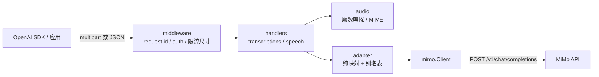
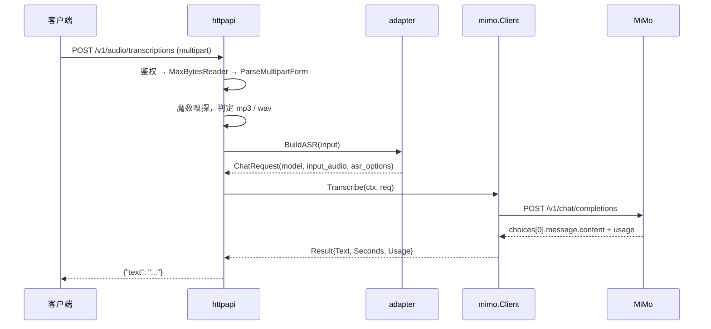
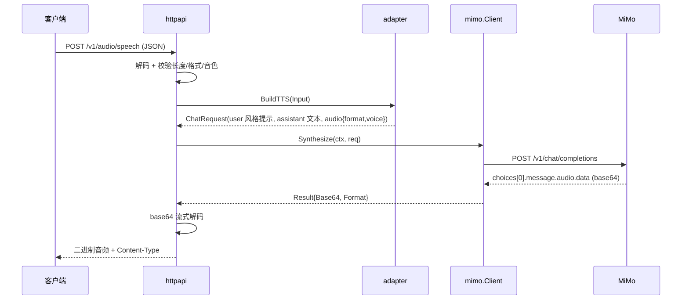

# 架构设计

> 描述目标态（M1–M4）。当前处于 M3：转写、合成与流式均已实现并通过官方端点实测。

## 1. 目标

1. 任何按 OpenAI `/v1/audio/*` 写的客户端，只改 `base_url` 就能用上 MiMo 的 ASR / TTS。
2. 单二进制、无状态：不落盘、不缓存、不依赖数据库或消息队列。
3. 协议翻译与网络 IO 分离，映射逻辑是纯函数，可以脱网单测。
4. 边界诚实：不支持的能力明确报错，不假装支持、不静默降级。

## 2. 非目标

| 不做 | 原因 |
| --- | --- |
| 音频转码 / 重采样 / 格式互转 | ffmpeg 会毁掉静态编译与镜像体积；不支持就 400 |
| 通用 LLM 代理 | 只覆盖 audio 两个端点，避免变成半成品网关 |
| 多租户、计费、配额 | 个人/小团队自托管场景，静态 token 足够 |
| 缓存与结果回查 | 音频含隐私，缓存收益低、风险高 |
| 异步任务 / 队列 | 上游同步接口，超时就报错，由客户端决定是否重试 |
| Web UI | 只提供 API |

## 3. 方案取舍

| 方案 | 优点 | 代价 | 结论 |
| --- | --- | --- | --- |
| 各客户端分别适配 | 没有中间层 | N 个客户端 × 每次上游变更，行为不一致 | 否 |
| 通用网关（LiteLLM / One API） | 现成、生态大 | 对 MiMo 音频模态无内置映射，要写插件；引入 Python 运行时 | 否，M4 可重新评估 |
| 专用薄适配层（本项目） | 映射可控、单二进制、容器友好、可测试 | 只覆盖两个端点 | **采用** |

关键判断：这层价值不在「转发」，而在**参数语义的显式对齐**（格式、语言、音色、错误码）。所以项目重心是 `internal/adapter` 的映射表与测试，而不是 HTTP 框架。

## 4. 组件与依赖方向



```text
cmd/mimivoice2api  →  internal/httpapi  →  internal/adapter  →  internal/mimo
                          │                     │
                          └──→ internal/audio ←─┘
```

- `adapter` 不 import `httpapi`，入参是自己的 Input 结构体，出参是 `mimo.ChatRequest`
- `mimo` 只依赖标准库，负责 HTTP、超时、错误分类、SSE 解析（M3）
- `audio` 只做格式判定，不含业务分支
- `config` 由 `cmd` 解析后按字段注入，其他包不读环境变量

## 5. 请求流水线

### 5.1 语音识别（M1）



要点：

1. 文件名与 multipart 的 `Content-Type` 都不可信，只看前 12 字节的魔数。
2. 音频转 data URL 时**只给 MIME，不给 `format` 字段**，避免两者不一致触发上游校验错误。
3. `usage.seconds` 用于 `verbose_json` 的 `duration`；缺失时该字段省略，不猜。

### 5.2 语音合成（M2）



要点：

1. 上游**非流式**默认 `format=wav`；**`stream=true` 时默认变 `pcm`**，所以无论哪种模式都必须显式下发 `audio.format`，否则 `Content-Type` 与实际字节不符。
2. 解码用 `base64.NewDecoder` 直接 `io.Copy` 到 `ResponseWriter`，不在内存里再复制一份音频。
3. 三种 MiMo TTS 模型共用同一端点，靠 `model` + `voice` / `instructions` 区分，规则见 [api-spec](api-spec.md#3-语音合成-post-v1audiospeech)。

## 6. 分层职责

| 层 | 负责 | 不负责 |
| --- | --- | --- |
| `httpapi` | 路由、鉴权、请求体限制、multipart/JSON 解析、错误 envelope、响应头 | 任何字段语义映射 |
| `adapter` | OpenAI 字段 → MiMo 字段、别名表、取值校验、降级规则 | 读环境变量、发 HTTP、写响应 |
| `mimo` | 上游请求构造与发送、超时、状态码分类、SSE 解析 | 下游协议兼容 |
| `audio` | 魔数嗅探、格式 ↔ MIME ↔ 文件扩展名 | 转码、解码音频内容 |
| `config` | 环境变量解析、默认值、启动校验 | 运行时热更新 |

## 7. 数据与内存模型

### 7.1 上传体积

- `MAX_UPLOAD_BYTES` 默认 25 MiB，用 `http.MaxBytesReader` 在解析前设限，超限返回 413。
- base64 膨胀系数 4/3：25 MiB 音频 → 约 33.4 MiB 的 `input_audio.data` 字符串。
- M1 采用**全量 buffer**：峰值内存 ≈ 原始音频 + base64 字符串 + JSON body ≈ 3 倍上传大小，单请求百 MiB 量级。
  - 理由：25 MiB 上限下可接受，代码简单，`Content-Length` 明确、便于上游错误分类。
  - 代价：并发大文件时 RSS 上升。缓解手段是把 `MAX_UPLOAD_BYTES` 调小，而不是提前上流式。
- 若 M3 后确需 >25 MiB，再改 `io.Pipe` + `base64.NewEncoder` 流式上送；代价是失去 `Content-Length`、上游可能改用 chunked、失败无法重放。

### 7.2 响应体积

- ASR 文本是小对象，直接 `string`。
- TTS 音频不整段解码，`base64.NewDecoder` 包住响应字符串后流式拷贝。
- 不主动设置 `Content-Length`（上游给的是 base64 长度，不是解码后长度）；小响应由 `net/http` 自动补齐，较大响应走 chunked。

## 8. 超时、取消与并发

| 项 | 默认值 | 说明 |
| --- | --- | --- |
| `ReadHeaderTimeout` | 5s | 防慢速头攻击 |
| `ReadTimeout` | 60s | 覆盖 25 MiB 上传 |
| `WriteTimeout` | 0（不设） | 流式响应不能有整体写超时，否则长音频会被截断 |
| `IdleTimeout` | 120s | keep-alive 空闲回收 |
| `UPSTREAM_TIMEOUT` | 180s | 单次上游请求，含连接与读取 |
| 优雅退出 | 10s | `SIGINT` / `SIGTERM` 后停止收新请求并等待在途请求 |

- `context` 从 handler 一路传到 `mimo.Client`；客户端断开即取消上游请求，避免继续计费。
- 不做服务端排队与并发上限：并发由 `net/http` 自然承接，上游 429 原样映射为 429 并透传 `Retry-After`。
- 只对 429 重试一次，且必须带可接受的 `Retry-After`（≤ 10 s，支持秒数与 HTTP-date）。其它错误一律不重试：生成类请求重试会重复计费，TTS 结果也不确定。

## 9. 错误传播

```text
mimo.Client 分类（transport / status / body）
        ↓
adapter 归一化为 Error{HTTPStatus, Type, Code, Param, Message}
        ↓
httpapi 输出 {"error": {...}}，并写 X-Request-ID
```

| 上游情况 | 下游响应 | 理由 |
| --- | --- | --- |
| 400 / 422 参数错误 | 502 `upstream_invalid_request` | 多数是我们的映射 bug，消息保留上游原文便于定位 |
| 401 / 403 | 502 `upstream_auth_error` | 透传 401 会让客户端误以为自己的 token 失效 |
| 404（通常是 `MIMO_BASE_URL` 配错） | 502 `upstream_bad_response` | 对客户端不是参数错误，属于部署问题 |
| 429 | 429 `rate_limited` + `Retry-After` | 背压交给客户端 |
| 5xx | 502 `upstream_error` | 网关语义 |
| 超时 / 连接失败 | 504 `upstream_timeout` / 502 `upstream_unreachable` | 区分可重试与不可达 |
| `finish_reason=length` | 502 `upstream_truncated` | 结果不完整，静默返回截断文本更糟 |

约束：

- 上游 `message` 截断到 512 字符再返回，防止超长 HTML 错误页灌进客户端。
- 任何情况下都不回显 `MIMO_API_KEY`、请求头、音频内容。
- 未捕获 panic 由 recover 中间件转 500 `internal_error`，堆栈只进日志。
- 流式响应一旦发出就无法再改状态码：SSE 用 `*.error` 事件收尾；二进制音频模式已经写出字节时，
  主动 `panic(http.ErrAbortHandler)` 断开连接，绝不再追加 JSON（否则会被当成音频数据）。
  recover 中间件对 `ErrAbortHandler` 原样透传，访问日志用 defer 记录，保证中止请求仍可观测。

## 10. 日志与可观测性

`log/slog`，JSON 输出（`LOG_FORMAT=text` 便于本地调试）。固定字段：

| 字段 | 说明 |
| --- | --- |
| `request_id` | 客户端传入（合法时复用）或服务端生成，回写响应头 |
| `route` | `transcriptions` / `speech` / `models` / `healthz` |
| `model_requested` | 客户端原始 `model` |
| `model_upstream` | 实际发往 MiMo 的模型 ID |
| `status` | 下游 HTTP 状态码 |
| `dur_ms` | 端到端耗时 |
| `in_bytes` | 实际读入的请求体字节数（multipart 时含边界与其它字段，不是 base64 长度） |
| `out_bytes` | 整体写出的字节数（音频或 SSE 事件文本） |
| `upstream_status` | 上游 HTTP 状态码 |
| `err_code` | 归一化错误码 |

禁止记录：音频字节、base64、转写文本、合成文本、API Key、完整请求头。

### 10.1 指标

`internal/metrics` 是一个零依赖的 Prometheus 文本格式实现（计数器、gauge、直方图），
不引入 `client_golang`，保持「单个静态二进制、无第三方依赖」的边界。

采集点在两处：

- `withAccessLog`：请求计数（`route` × `status` × `err_code`）、端到端时延直方图、请求/响应字节数、在途 gauge
- `mimo.Client` 的 observer：每次上游**尝试**的结果与到响应头耗时；429 重试会记录两次，这是刻意的，便于区分「下游请求数」与「上游压力」

`/metrics` 自身需要鉴权（`AUTH_TOKEN`），避免用量数据泄露。在途 gauge 在抓取时会包含抓取请求本身，
基线为 1 而非 0。运行时的 goroutine 与堆指标在抓取时用 `runtime.ReadMemStats` 现取，不做后台轮询。

标签基数受控：`route` 是固定枚举，`status` 只会出现本项目定义的状态码，`err_code` 来自固定错误码表，
`kind` 来自 `mimo.ErrorKind`，都不接受用户输入。

## 11. 部署形态

### 11.1 镜像

- 多阶段：`golang:1.26-alpine` 构建 → `alpine:3` 运行（需要 `ca-certificates` 与 `wget` 做健康检查）
- 构建参数：`CGO_ENABLED=0`、`-trimpath`、`-ldflags "-s -w -X main.version=... -X main.commit=..."`
- 发布：tag `v*` 触发 buildx，产出 `linux/amd64` 与 `linux/arm64` 双架构镜像到 GHCR

```dockerfile
FROM golang:1.26-alpine AS build
WORKDIR /src
# 零第三方依赖，没有 go.sum；保留这一步是为了依赖出现时缓存仍然有效
COPY go.mod ./
RUN go mod download
COPY . .
ARG VERSION=dev
ARG COMMIT=none
RUN CGO_ENABLED=0 go build -trimpath \
    -ldflags "-s -w -X main.version=${VERSION} -X main.commit=${COMMIT}" \
    -o /out/mimivoice2api ./cmd/mimivoice2api

FROM alpine:3
RUN apk add --no-cache ca-certificates tzdata \
 && addgroup -g 10001 app && adduser -u 10001 -G app -S -D app
COPY --from=build /out/mimivoice2api /app/mimivoice2api
USER 10001:10001
EXPOSE 8080
HEALTHCHECK --interval=30s --timeout=3s --start-period=5s \
  CMD wget -qO- http://127.0.0.1:8080/healthz >/dev/null || exit 1
ENTRYPOINT ["/app/mimivoice2api"]
```

- 目标体积：< 25 MB（实际约 15 MB，`-s -w` 后的静态二进制约 7 MB + alpine 基础层）
- 不用 distroless：需要 `wget` 做 HEALTHCHECK，且国内拉取 `gcr.io` 不稳定

### 11.2 Compose

```yaml
services:
  mimivoice2api:
    image: ghcr.io/mcxiaochenn/mimivoice2api:latest
    env_file: .env
    ports:
      - "127.0.0.1:8080:8080"
    read_only: true
    tmpfs:
      - /tmp
    security_opt:
      - no-new-privileges:true
    cap_drop:
      - ALL
    pids_limit: 256
    stop_grace_period: 15s
    restart: unless-stopped
    healthcheck:
      test: ["CMD", "wget", "-qO-", "http://127.0.0.1:8080/healthz"]
      interval: 30s
      timeout: 3s
      retries: 3
    logging:
      driver: json-file
      options:
        max-size: "10m"
        max-file: "3"
```

端口默认只绑 `127.0.0.1`，对外暴露交给反代（Caddy / Nginx）处理 TLS。

## 12. 已识别的坑位

| 编号 | 坑 | 处理 |
| --- | --- | --- |
| T1 | `stream=true` 时上游默认输出 `pcm` | 任何模式都显式下发 `audio.format` |
| T2 | ASR 只接受 `mp3` / `wav`，且 MIME 与 `format` 同时出现时必须一致 | 只发 data URL，不带 `format` 字段 |
| T3 | multipart 的 `Content-Type` 常是 `application/octet-stream` | 只看魔数，不看声明 |
| T4 | base64 膨胀 4/3，25 MiB 上传 ≈ 33 MiB 请求体 | 按 3 倍估算内存，限制并发大文件 |
| T5 | 上游 401 透传会让客户端清空自己的凭据 | 映射为 502，日志里记录上游状态 |
| T6 | 中文音色 ID（`冰糖`）被 JSON 编码成 `\uXXXX` 虽合法，但不利于日志排查 | `SetEscapeHTML(false)`，日志按原文输出 |
| T7 | `mimo-v2.5-tts-voicedesign` 必带 `user` 消息且不接受 `voice` | 传 `voice` 直接 400，避免用户以为生效 |
| T8 | ASR 只支持单段音频 | 多文件或多段直接 400 |
| T9 | `optimize_text_preview` 仅 voicedesign 生效，且可省略 assistant 消息 | 本适配层不暴露该参数，避免语义分叉 |
| T10 | 上游可能因长度限制返回 `finish_reason=length` | 502 `upstream_truncated`，提示拆分输入，不返回半截结果 |

## 13. 演进方向

| 方向 | 触发条件 | 备注 |
| --- | --- | --- |
| 流式转写 / 流式合成 | 已实现（M3） | 分片可独立解码，逐片透传；wav 因分片是独立文件而走非流式 |
| 429 单次重试 | 已实现（M3） | 只对 429，必须带 `Retry-After`，等待上限 10 s，总计重试一次 |
| Prometheus 指标 | 需要接入监控时（M4） | 只加 `/metrics`，不引入额外中间件 |
| 多上游路由 | 出现第二个兼容上游时 | 用 `model` 前缀路由，不做通用网关 |
| ffmpeg 转码 | 明确不做 | 需要时由调用方前置处理 |
